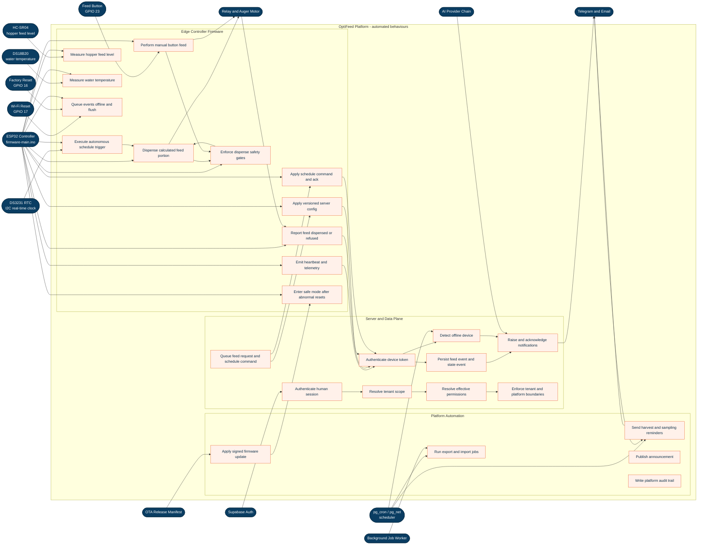
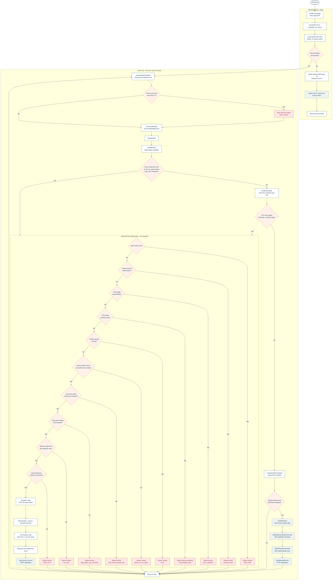
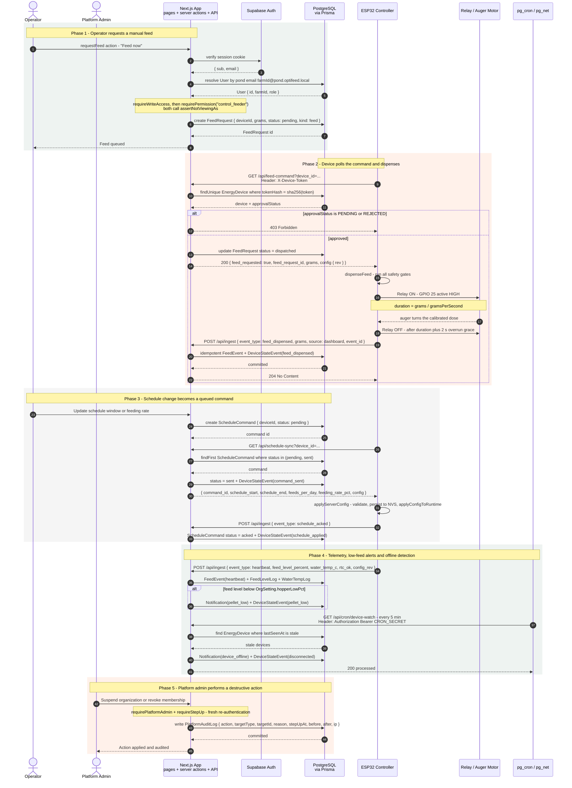
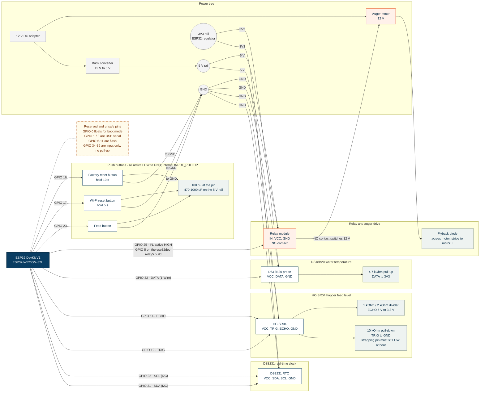

# OptiFeed — Multi-Tenant System Diagrams

**Status:** as-built
**Verified against code:** 2026-10-31
**Base:** `origin/develop` @ `f7fd987`
**Scope:** the multi-tenant OptiFeed precision fish-feeding platform — Next.js 16 App Router, PostgreSQL via Prisma, Supabase Auth, and the ESP32 edge controller.

> These figures are generated **from the code, not from screenshots**. Every element is traced to a source file in [§7 Traceability](#7-traceability). Where an earlier diagram contradicts the code, the code wins; the differences are recorded in [§8](#8-differences-from-the-september-2026-diagram-audit).

---

## 0. Figure index

| Figure | Type | Mermaid source | Rendered |
|---|---|---|---|
| 3.1 | Use Case Diagram (User) | [`docs/diagrams/01-use-case-user.mmd`](diagrams/01-use-case-user.mmd) | [`figure-3.1-use-case-user.png`](diagrams/figure-3.1-use-case-user.png) |
| 3.2 | Use Case Diagram (System) | [`docs/diagrams/02-use-case-system.mmd`](diagrams/02-use-case-system.mmd) | [`figure-3.2-use-case-system.png`](diagrams/figure-3.2-use-case-system.png) |
| 3.3 | Activity Diagram of System Hardware | [`docs/diagrams/03-activity-hardware.mmd`](diagrams/03-activity-hardware.mmd) | [`figure-3.3-activity-hardware.png`](diagrams/figure-3.3-activity-hardware.png) |
| 3.4 | Sequence Diagram | [`docs/diagrams/04-sequence.mmd`](diagrams/04-sequence.mmd) | [`figure-3.4-sequence.png`](diagrams/figure-3.4-sequence.png) |
| 3.5 | Circuit Diagram | [`docs/diagrams/05-circuit.mmd`](diagrams/05-circuit.mmd) | [`figure-3.5-circuit.png`](diagrams/figure-3.5-circuit.png) |

The `.mmd` files are the single source of truth. The blocks below are spliced from them verbatim by `scripts/build-diagram-doc.mjs`, so the document and the sources cannot drift.

```bash
node scripts/build-diagram-doc.mjs
```

To re-render the PNGs after editing a `.mmd` source:

```bash
node scripts/render-diagrams.mjs
```

GitHub renders the Mermaid blocks natively; the PNGs exist for documents, slide decks and PDF export.

---

## 1. The multi-tenancy structure these diagrams describe

### 1.1 Hierarchy

```text
Platform  (cross-tenant)
└── PlatformAdmin              god mode; every mutation audited, destructive ones step-up
    │
Organization                  ← THE TENANT BOUNDARY
├── Membership                 (userId, role, revokedAt)
├── MembershipPermission       (membershipId, permission, grantedAt, revokedAt)
├── OrgSetting                 per-tenant feeding defaults, alert roles, registration mode
└── User                       (farmId = login slug, legacy role flag)
    └── Farm                   (ownerId)
        └── Pond               (farmId, ownerId, schedule window, feeding rate)
            ├── CropCycle, PondEvent, BiomassLog, FcrReport
            ├── FeedLevelLog, WaterTempLog, Notification
            └── EnergyDevice    ← the feeder controller (tokenHash, approvalStatus)
```

`Organization`, `Membership`, `MembershipPermission` and `PlatformAdmin` are **relation-free by design** — no foreign key to `User`, `Farm` or `Pond`. Tenancy is an explicit id join resolved in application code, which is why every tenant query must apply the scope filter explicitly.

### 1.2 Two independent authorities

| | Tenant authority | Platform authority |
|---|---|---|
| Source of truth | `Membership` with `revokedAt = null` inside an `Organization` with `status = ACTIVE` | `PlatformAdmin` with `revokedAt = null` and a non-expired `expiresAt` |
| Roles | `OWNER`, `ADMIN` open the tenant console | god mode, opens the platform console |
| Guard | `requireTenantAdmin()` — `apps/web/lib/auth/tenant-admin.ts:84` | `requirePlatformAdmin()` — `apps/web/lib/auth/require-platform-admin.ts:58` |
| Cross-tenant reach | none | all tenants — but the platform grant confers **no** tenant write power |
| Mutation record | `DeviceStateEvent` / org audit trail | `PlatformAuditLog` with a mandatory `reason` |

`User.role` is a legacy global flag and is **not** tenant authority. A user whose `User.role` is `ADMIN` but who holds only an `OPERATOR` membership is not a tenant admin — the membership wins.

### 1.3 Permission resolution

```text
session → User → Memberships (revokedAt = null)
        → Organizations with status = ACTIVE
        → MembershipPermission rows for those memberships
        → ROLE_DEFAULTS[role]  +  explicit grants  −  explicit revocations
```

- Ten permissions, listed in `apps/web/lib/auth/permissions.ts:11`.
- Role defaults always apply (`permissions.ts:42`), so a membership with **no** permission rows behaves exactly as it did before the permission table existed. That is the compatibility bridge that stopped the bootstrap migration from locking out existing accounts.
- A revoked row denies, **even for `OWNER`**. That is what makes `control_feeder` independently revocable for an otherwise-`ADMIN` member.
- Unknown permission strings are ignored, never granted (`isPermission` is the runtime gate).
- Resolution is **fail-closed**: no session, no membership, or no `ACTIVE` organization all yield the empty set (`getCurrentPermissions`, `permissions.ts:110`).

### 1.4 Scope resolution — the actual isolation boundary

`resolveOrgScope()` (`apps/web/lib/auth/org-scope.ts:100`) walks:

```text
User.farmId → Membership(OWNER|ADMIN, revokedAt = null)
            → Organization(status = ACTIVE)
            → member User.farmId
            → Pond.ownerId
            → Pond.id
```

It returns `EMPTY_SCOPE` at every missing link. A missing scope therefore produces an **empty** result set, never an unscoped global one, so there is no code path in which forgetting to apply the scope leaks all tenants.

> **Known limitation** (recorded in [ADR-0006](adr/0006-multi-tenant-rbac.md)): `getCurrentPermissions()` unions every active membership, so permission resolution is not yet per-organization and there is no org switcher. The cross-tenant isolation boundary is `resolveOrgScope()` plus the ownership filters — not the permission union. Row-level security defence-in-depth (`db.forOrg()`, M8.3) is not implemented.

---

## 2. Figure 3.1 — Use Case Diagram (User)

```mermaid
flowchart LR

  classDef actor fill:#0a3d62,stroke:#0a2e47,color:#ffffff,stroke-width:1.5px;
  classDef uc fill:#ffffff,stroke:#0a3d62,color:#0a2e47;
  classDef helper fill:#eef3f1,stroke:#7a8c85,color:#0a2e47,stroke-dasharray:4 3;
  classDef ext fill:#f4f4f5,stroke:#71717a,color:#27272a,stroke-dasharray:4 3;

  PA(["Platform Admin<br/>cross-tenant god mode"]):::actor
  OA(["Tenant OWNER / ADMIN<br/>tenant admin console"]):::actor
  OP(["OPERATOR<br/>farm operator"]):::actor
  VW(["VIEWER<br/>read-only"]):::actor
  DV(["Feed Controller<br/>ESP32 device actor"]):::actor

  subgraph PLATFORM["OptiFeed Multi-Tenant Precision Feeding Platform"]

    subgraph TCON["Tenant Console  /dashboard  -  own-farm scope"]
      direction TB
      U1["View control-room dashboard<br/>feeder, hopper, water temp, prediction"]
      U2["Log biomass samples<br/>weight, length, population"]
      U3["Log and review feeding history"]
      U4["View growth and FCR reports"]
      U5["View merged feed and harvest calendar"]
      U6["Request manual feed now"]
      U7["Manage schedule window and feeding rate"]
      U8["Run calibration<br/>hopper, duration, temperature"]
      U9["Acknowledge notifications"]
      U10["Export and import pond data"]
      U11["Read own-farm device audit trail"]
      H1["Recalculate next feeding amount"]:::helper
      H2["Persist grams-per-second calibration"]:::helper
    end

    subgraph ACON["Tenant Admin Console  /admin  -  organization scope"]
      direction TB
      A1["Invite, re-role and revoke members"]
      A2["Grant and revoke per-member permissions"]
      A3["Create, edit, move and delete ponds"]
      A4["Register, approve and claim feeders"]
      A5["Reveal device token and rotate it"]
      A6["Update organization settings<br/>feeding rate, hopper low, alert roles"]
      A7["Read organization audit trail"]
      A8["Export tenant-scoped data backup"]
    end

    subgraph SCON["Platform Console  /superadmin  -  all tenants"]
      direction TB
      S1["Create and manage organizations"]
      S2["Suspend, schedule deletion, purge tenant"]
      S3["Create users and grant platform admin"]
      S4["Register device and rotate device token"]
      S5["Remote feed or pause any device"]
      S6["View-as a tenant (read-only impersonation)"]
      S7["Publish announcements, feature flags, AI providers"]
      S8["Read platform audit log and error events"]
      S9["Full-database backup export"]
    end

    subgraph EDGE["Device Edge  -  poll and push, device-token authenticated"]
      direction TB
      D1["Send heartbeat telemetry"]
      D2["Report feed dispensed or refused"]
      D3["Poll pending feed command"]
      D4["Poll pending schedule command"]
      D5["Check for signed firmware update"]
    end
  end

  %% ---------------- farmer / operator ----------------
  OP --> U1
  OP --> U2
  OP --> U3
  OP --> U4
  OP --> U5
  OP --> U6
  OP --> U7
  OP --> U8
  OP --> U9
  OP --> U10
  OP --> U11
  U2 -.->|"<<include>>"| H1
  U8 -.->|"<<include>>"| H2

  %% ---------------- viewer ----------------
  VW --> U1
  VW --> U4
  VW --> U5

  %% ---------------- tenant admin ----------------
  OA --> A1
  OA --> A2
  OA --> A3
  OA --> A4
  OA --> A5
  OA --> A6
  OA --> A7
  OA --> A8
  OA --> U1
  A1 -.->|"<<extend>>"| A2

  %% ---------------- platform admin ----------------
  PA --> S1
  PA --> S2
  PA --> S3
  PA --> S4
  PA --> S5
  PA --> S6
  PA --> S7
  PA --> S8
  PA --> S9

  %% ---------------- device ----------------
  DV --> D1
  DV --> D2
  DV --> D3
  DV --> D4
  DV --> D5
```



### 2.1 Console, route and guard matrix

| Console | Route group | Layout guard | Scope |
|---|---|---|---|
| Farmer | `/dashboard` | `requirePasswordChanged()` | own farm only |
| Tenant admin | `/admin` | `requireTenantAdmin()` | the caller's organizations |
| Platform | `/superadmin` | `requirePlatformAdmin()` | all tenants |
| Label printing | `/print/admin/...`, `/print/superadmin/...` | tenant admin / platform admin | as above |

### 2.2 Role and permission matrix

| Permission | OWNER | ADMIN | OPERATOR | VIEWER |
|---|:---:|:---:|:---:|:---:|
| `view_dashboard` | yes | yes | yes | yes |
| `view_reports` | yes | yes | — | yes |
| `manage_members` | yes | yes | — | — |
| `manage_farms_ponds` | yes | yes | — | — |
| `manage_schedule` | yes | yes | yes | — |
| `manage_crop_cycle` | yes | yes | yes | — |
| `claim_feeder` | yes | yes | yes | — |
| `control_feeder` | yes | yes | yes | — |
| `record_dispatch` | yes | yes | — | — |
| `view_billing` | yes | yes | — | — |

Source: `ROLE_DEFAULTS` in `apps/web/lib/auth/permissions.ts:42`. Every cell can still be overridden per membership: an unrevoked `MembershipPermission` row grants, a revoked row denies.

### 2.3 Three rules that shape every use case

1. **The UI is not the security boundary.** Permission checks are server-side in `requirePermission()` (`apps/web/lib/auth/permissions.ts:178`). Pages use `hasPermission()` only to hide controls for usability; hiding is never the enforcement.
2. **View-as is strictly read-only.** A platform admin impersonating a tenant may read everything and write nothing. `assertNotViewingAs()` (`apps/web/lib/auth/view-as.ts:282`) is called by `requireWriteAccess`, by `requirePermission`, and by both backup export routes.
3. **Destructive and device actions need step-up re-authentication.** `requireStepUp()` (`apps/web/lib/auth/step-up.ts:179`) demands a fresh password confirmation, and the action writes a `PlatformAuditLog` row carrying `reason`, `stepUpAt`, `before`, `after` and `ip`.

---

## 3. Figure 3.2 — Use Case Diagram (System)



The system diagram separates the **edge controller firmware** (which keeps feeding even with the network down, because the DS3231 RTC holds the schedule) from the **server and data plane** (which owns tenancy, permissions, persistence and alerting).

Three consequences worth stating explicitly:

- **Local autonomy.** If the server is unreachable, the RTC schedule still fires and the physical button still works. Only the *reporting* stops: events are queued in NVS and flushed on the next successful poll (`flushQueuedEvents`).
- **The server never drives the relay directly.** The server writes a `FeedRequest` or a `ScheduleCommand` row; the device picks it up by polling. There is no push channel to the device.
- **The platform console is a separate authority, not a super-role.** It can read and command across tenants, but it cannot grant itself tenant permissions — it can only change memberships, and that change is audited.

---

## 4. Figure 3.3 — Activity Diagram of System Hardware



### 4.1 Dispense refusal codes

Every gate in the `dispenseFeed` chain maps to a stable reason string, so a refusal is visible in the server audit trail instead of being silently dropped.

| Reason | Meaning | Source |
|---|---|---|
| `safe_mode` | the unit is in safe mode after repeated abnormal resets | `firmware/firmware-main/safety.h:39` |
| `brownout_hold` | inside the post-brownout hold window after a power fault | `safety.h:40` |
| `ota_in_progress` | a signed firmware image is downloading | `safety.h:41` |
| `ota_pending_verify` | a freshly installed image has not passed its health check yet | `safety.h:42` |
| `busy` | the feeder is already running (mutex held) | `safety.h:43` |
| `grams_out_of_range` | the dose is zero or above the per-dose ceiling | `safety.h:44` |
| `dose_time_exceeds_cap` | `grams / gramsPerSecond` exceeds the relay-time envelope | `safety.h:45` |
| `daily_gram_cap_exceeded` | the daily gram ceiling would be broken | `safety.h:46` |
| `too_soon` | the minimum gap since the last dispense has not elapsed | `safety.h:47` |
| `hourly_limit` | the rolling-hour dispense ceiling is reached | `safety.h:48` |
| `relay_overrun` | the dose ran more than 2 s past its expected end | `safety.h:49` |

### 4.2 Default safety envelope

| Limit | Default | Source |
|---|---|---|
| `min_dispense_gap_s` | 10 s | `firmware/firmware-main/config.h:51` |
| `max_dispenses_per_hour` | 6 | `config.h:52` |
| `max_grams_per_day` | 5 000 g | `config.h:53` |
| `max_dispense_ms` | 300 000 ms (5 min) | `config.h:54` |
| `calibration_max_grams` | 5 000 g | `config.h:55` |
| `calibration_max_dispense_ms` | 600 000 ms (10 min) | `config.h:56` |
| `button_quiet_after_dispense_ms` | 2 000 ms | `config.h:85` |
| `heartbeat_interval_s` | 5 s | `config.h:95` |
| `offline_after_min` | 15 min | `config.h:98` |

There is **no per-dose gram cap**: the daily ceiling is the only gram budget, and a single dose may consume all of it, bounded only by the relay-time envelope. Calibration is the one deliberate exception, with its own grams and duration ceilings.

### 4.3 Schedule behaviour

`handleSchedule()` (`firmware/firmware-main/firmware-main.ino:3574`) fires when the RTC hour **and** minute both match a configured feed time, once per day (`firedToday` flag reset on a day change). The default schedule loaded at boot is **06:00 and 19:00** (`firmware-main.ino:3315-3320`); the server-supplied schedule replaces it through `/api/schedule-sync`.

> The September 2026 activity diagram showed a "feed sufficient?" gate that would skip a dispense when the hopper is low. **That gate does not exist.** The HC-SR04 level is measured once per heartbeat and reported; a low level raises a `pellet_low` notification but never blocks a dispense. The level is also *not* a dispense-success sensor — there is no "did the feed actually drop?" check, so the relay-time model is the only dispense control.

---

## 5. Figure 3.4 — Sequence Diagram



### 5.1 The three credential families

| | Humans | Devices | Cron |
|---|---|---|---|
| Credential | Supabase session cookie | `X-Device-Token` header | `Authorization: Bearer $CRON_SECRET` |
| Lookup | `getVerifiedSession()` → the session email must be `<farmId>@pond.optifeed.local` | `sha256(token)` → `EnergyDevice.tokenHash`, and `device_id` must equal the device MAC | timing-safe constant-time comparison |
| Extra check | `mustChangePassword` must be false | `approvalStatus = APPROVED`, otherwise **403** | `CRON_SECRET` must be set and match, otherwise **403** |
| Rate limit | per-user bucket | 1 request/s on ingest, separate device poll bucket | none |

The pond-email convention is what stops a look-alike domain from ever acting as a farm: a user resolves only when the session email is a pond-provisioned address that matches `User.farmId`.

### 5.2 Device endpoints

All device calls use the legacy `/api/*` prefix, which the server rewrites from the canonical `/api/v1/*` (`apps/web/next.config.ts:97-99`).

| Endpoint | Method | Purpose | Firmware reference |
|---|---|---|---|
| `/api/ingest` | POST | heartbeat, `feed_dispensed`, `schedule_acked`, `feed_refused` | `firmware-main.ino:106` |
| `/api/feed-command` | GET | long-poll for a pending `FeedRequest` | `firmware-main.ino:109` |
| `/api/schedule-sync` | GET | long-poll for a pending or sent `ScheduleCommand` | `firmware-main.ino:110` |
| `/api/firmware/check` | GET | signed OTA manifest check | `firmware-main.ino:123` |

### 5.3 Scheduled background work

There is no Vercel cron block. Scheduling is Supabase `pg_cron` + `pg_net`, configured per environment from the SQL in `docs/sql/`.

| Job | Schedule | Endpoint | Purpose |
|---|---|---|---|
| `cron-device-watch.sql` | every 5 min | `POST /api/cron/device-watch` | offline detection, calibration reminders, retention sweeps |
| `cron-crop-watch.sql` | daily 22:00 | `POST /api/cron/crop-watch` | harvest and sampling reminders, idempotent via `ReminderLog.dedupeKey` |
| `cron-jobs.sql` | every minute | `GET /api/cron/jobs?max=5` | background job worker, claims with `FOR UPDATE SKIP LOCKED` |

---

## 6. Figure 3.5 — Circuit Diagram



### 6.1 Pin map

| GPIO | Connects to | Notes |
|---|---|---|
| 25 | Relay `IN` | Active HIGH by default. `-DRELAY_PIN=5` builds the `esp32dev-relay5` environment used by the CICT Building A unit. |
| 23 | Feed button → GND | `INPUT_PULLUP`, press = LOW. A press must stay LOW for 50 ms; edges during a dispense and for 2 s after are ignored; one button dose per 30 s; a 5 s hold at boot resets Wi-Fi. |
| 16 | Factory reset button → GND | `INPUT_PULLUP`, hold 10 s — clears Wi-Fi, Device ID, Device Token and the provisioned marker. |
| 17 | Wi-Fi reset button → GND | `INPUT_PULLUP`, hold 5 s — clears Wi-Fi only, keeps the device identity. |
| 21 | DS3231 `SDA` | I²C real-time clock. |
| 22 | DS3231 `SCL` | I²C real-time clock. |
| 32 | DS18B20 `DATA` | 1-Wire water temperature probe, 4.7 kΩ pull-up to 3V3. |
| 12 | HC-SR04 `TRIG` | Output. Strapping pin — a 10 kΩ pull-down to GND holds it LOW at boot. |
| 14 | HC-SR04 `ECHO` | Input at 5 V logic — divide to 3.3 V before the pin (1 kΩ / 2 kΩ). |

Sources: `firmware/firmware-main/firmware-main.ino:352-394`, the `firmware/README.md` pin table, and `docs/hardware/2026-10-28-cict-pin-map-and-health.md`.

### 6.2 Power and notes

- **Power tree.** A 12 V DC adapter feeds the relay contacts and the auger motor directly. A buck converter steps 12 V → 5 V for the relay module and the HC-SR04. The ESP32's own regulator supplies the 3V3 rail for the DS3231, the DS18B20 and every pull-up.
- **No buzzer.** The September 2026 circuit diagram showed an active buzzer for "system notifications". The firmware has no buzzer output — notifications are software (Supabase Realtime, Telegram, email). The block was removed rather than drawn as planned hardware.
- **Motor flyback.** A flyback diode is required across the motor, stripe to motor `+`. The 2026-10-28 field check recorded phantom button feeds traced to relay/motor switching noise coupling into the GPIO 23 line; the recommended hardware fix is a 10 kΩ pull-up plus a 100 nF capacitor at the pin, twisted button wiring, the flyback diode, and 470–1000 µF on the 5 V rail. Firmware 1.5.3 already suppresses the symptom (50 ms confirmation, 2 s quiet window, 30 s cooldown) but does not remove the noise.
- **Reserved pins.** GPIO 0 must float during boot, GPIO 1 / 3 are the USB debug serial, GPIO 6–11 are the flash, and GPIO 34–39 are input-only with no internal pull-up.

---

## 7. Traceability

| Element in the figures | Source of truth |
|---|---|
| Tenancy hierarchy, `OrgStatus`, `MemberRole` | `apps/web/prisma/schema.prisma:526-585` |
| `PlatformAdmin`, `PlatformAuditLog`, `ImpersonationSession` | `apps/web/prisma/schema.prisma:587-627` |
| `OrgSetting` (feeding defaults, alert roles, registration mode) | `apps/web/prisma/schema.prisma:721-731` |
| `EnergyDevice`, `FeedRequest`, `ScheduleCommand`, `DeviceStateEvent`, `FeedEvent` | `apps/web/prisma/schema.prisma:326-470` |
| Permission catalogue and role defaults | `apps/web/lib/auth/permissions.ts:11,42` |
| `effectivePermissions` grant/revoke resolution | `apps/web/lib/auth/permissions.ts:76` |
| Fail-closed permission union | `apps/web/lib/auth/permissions.ts:110` |
| `requirePermission` (server-side enforcement) | `apps/web/lib/auth/permissions.ts:178` |
| Tenant scope resolution | `apps/web/lib/auth/org-scope.ts:100` |
| Tenant admin console guard | `apps/web/lib/auth/tenant-admin.ts:84` |
| Platform console guard | `apps/web/lib/auth/require-platform-admin.ts:58` |
| View-as read-only guard | `apps/web/lib/auth/view-as.ts:282` |
| Step-up re-authentication | `apps/web/lib/auth/step-up.ts:179` |
| Session, email-to-farm binding, write guard | `apps/web/lib/auth/session.ts`, `apps/web/lib/auth/verify-session.ts` |
| Device token authentication and approval | `apps/web/lib/device-auth.ts`, `apps/web/app/api/ingest/route.ts` |
| Ingest event types | `apps/web/app/api/ingest/route.ts:67` |
| Feed command long-poll and versioned config | `apps/web/app/api/feed-command/route.ts` |
| Schedule command long-poll | `apps/web/app/api/schedule-sync/route.ts` |
| Cron authentication | `apps/web/lib/auth/with-auth.ts` (`withCronAuth`) |
| Background job worker | `apps/web/lib/jobs/service.ts`, `docs/sql/cron-jobs.sql` |
| Firmware pins | `firmware/firmware-main/firmware-main.ino:352-394`, `firmware/README.md` |
| Firmware main loop | `firmware/firmware-main/firmware-main.ino:3269` |
| `dispenseFeed` and its gates | `firmware/firmware-main/firmware-main.ino:3448` |
| `stopFeedCycle` and the overrun grace | `firmware/firmware-main/firmware-main.ino:3529` |
| RTC schedule trigger | `firmware/firmware-main/firmware-main.ino:3574` |
| Button press confirmation | `firmware/firmware-main/firmware-main.ino:3938`, `firmware/README.md` |
| Telemetry payload | `firmware/firmware-main/firmware-main.ino:4117` |
| Refusal reason strings | `firmware/firmware-main/safety.h:21-50` |
| Config envelope and defaults | `firmware/firmware-main/config.h:51-98` |
| Multi-tenancy decision record | `docs/adr/0006-multi-tenant-rbac.md` |
| Permission procedure | `docs/rbac-permissions.md` |

---

## 8. Differences from the September 2026 diagram audit

[`docs/diagram-audit-report.md`](diagram-audit-report.md) audited the five PNGs in `diagram/` against the code on 2026-09-25. The figures in this document supersede those screenshots.

| Finding | Issue in the old figures | Resolution in this document |
|---|---|---|
| F1 | Relay drawn on "GPIO 5" | Correct pin map with both builds: **GPIO 25** by default, **GPIO 5** only for the `esp32dev-relay5` environment used by the CICT unit (`firmware/platformio.ini`). |
| F2 | "Stream dispense via WebSocket" | The edge speaks **HTTPS** only. There is no WebSocket client in the firmware: `POST /api/ingest`, `GET /api/feed-command`, `GET /api/schedule-sync`, `GET /api/firmware/check`. |
| F3 | Unimplemented "feed sufficient?" and "dispense success?" gates | Removed. The HC-SR04 level is telemetry and an alert input, never a dispense gate, and there is no dispense-success sensor. |
| F4 | "View SGR" | Not implemented and not drawn. The Growth screen shows FCR, biomass averages and growth percentage. |
| F5 | Hard-coded "08:00 AM – 04:00 PM" | Use cases no longer hard-code example times. The firmware default schedule is **06:00 and 19:00**; the server-supplied schedule replaces it. |
| F6 | Buzzer in the circuit diagram | Removed. The firmware has no buzzer output. |
| F7 | Placeholder figure titles | Consistent sequential numbering: Figures 3.1 – 3.5. |
| F8 | 1024 × 559 px screenshots named after Facebook content IDs | Regenerated from Mermaid sources with meaningful names (`docs/diagrams/figure-3.*.png`), and the sources are committed so the figures can be regenerated when the code changes. |

Two further changes since the audit that the old figures did not cover at all:

- **Multi-tenancy is now modelled.** The old use case diagram had one generic "Farm Operator / Administrator" actor. There are now three consoles with three different guards and three different scopes.
- **Safety gates were added.** The dispense path now runs ten gates and eleven distinct refusal reasons (`firmware/firmware-main/safety.h`), plus the versioned server config contract and the signed OTA lifecycle.

---

## 9. Known limitations of these figures

1. **Mermaid is not UML.** Use cases are drawn as a flowchart with UML-style actor (`([…])`) and use case (`[…]`) shapes, and `<<include>>` / `<<extend>>` are edge labels. This is the convention already used elsewhere in this repository (`docs/system-functions-portal/diagrams/`).
2. **Figure 3.1 is tall.** Thirty-two use cases across three consoles cannot be both wide and short; the layout is a column per console.
3. **The figures show the implemented system, not the plan.** Items still marked as plan work in [`docs/SUPERADMIN-MULTITENANCY-PLAN.md`](SUPERADMIN-MULTITENANCY-PLAN.md) — per-organization permission resolution, the org switcher, `db.forOrg()`, row-level security, MFA enforcement — are deliberately absent rather than drawn as if they existed.
4. **The circuit diagram is a wiring map, not a PCB schematic.** It fixes the pin assignments and the passive components that the field checks depend on, but it does not carry part numbers, track routing or connector pinouts.
5. **Re-render after any change to the firmware or the tenancy model.** The diagrams are hand-maintained against the code; the traceability table in §7 is what makes them checkable.

---

## 10. Related documents

- [`docs/adr/0006-multi-tenant-rbac.md`](adr/0006-multi-tenant-rbac.md) — the multi-tenancy decision record
- [`docs/rbac-permissions.md`](rbac-permissions.md) — the permission procedure
- [`docs/diagram-audit-report.md`](diagram-audit-report.md) — the September 2026 audit of the original figures
- [`docs/hardware/2026-10-28-cict-pin-map-and-health.md`](hardware/2026-10-28-cict-pin-map-and-health.md) — field pin map and component health
- [`docs/system-context.html`](system-context.html) — the system context briefing
- [`docs/system-functions-portal/`](system-functions-portal/) — the interactive system functions portal
- [`firmware/README.md`](../firmware/README.md) — firmware behaviour and the pin table
